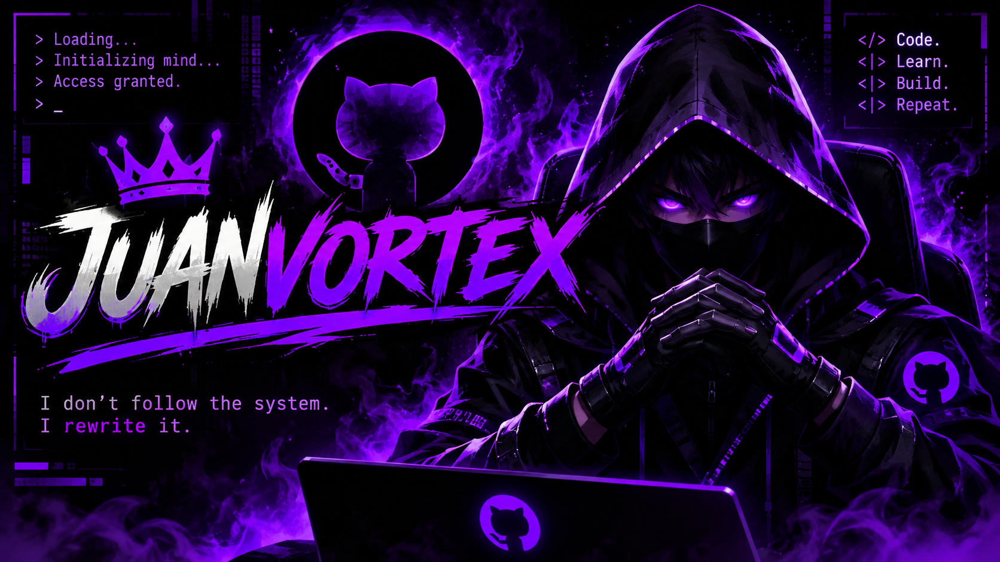

☠️ JUANVORTEX 🤖

I DON'T FOLLOW THE SYSTEM. I REWRITE IT.

---

"// THE OPERATOR"

«"Every line is a calculated move."»

- 🧠 ICT graduate exploring the world of technology.
- 🤖 Interested in Artificial Intelligence and Machine Learning.
- 💻 Learning programming and building digital solutions.
- ⚡ Focused on problem-solving, creativity, and continuous growth.
- ♟️ Silent moves. Ruthless logic. Zero limits.

---

"// ARSENAL"

Languages & Tools

---

"// CURRENT DIRECTIVE"

class JuanVortex:
    def __init__(self):
        self.name = "JUANVORTEX"
        self.focus = [
            "Artificial Intelligence",
            "Machine Learning",
            "Programming",
            "Technology"
        ]
        self.mindset = "Never stop learning"

    def execute(self):
        return "Building something extraordinary..."

vortex = JuanVortex()
print(vortex.execute())

---

"// THE CODE"

---

⚡ ACCESS GRANTED. THE STORY IS STILL LOADING.

Stay curious. Stay dangerous.

♟️ "JUANVORTEX" © 2026

